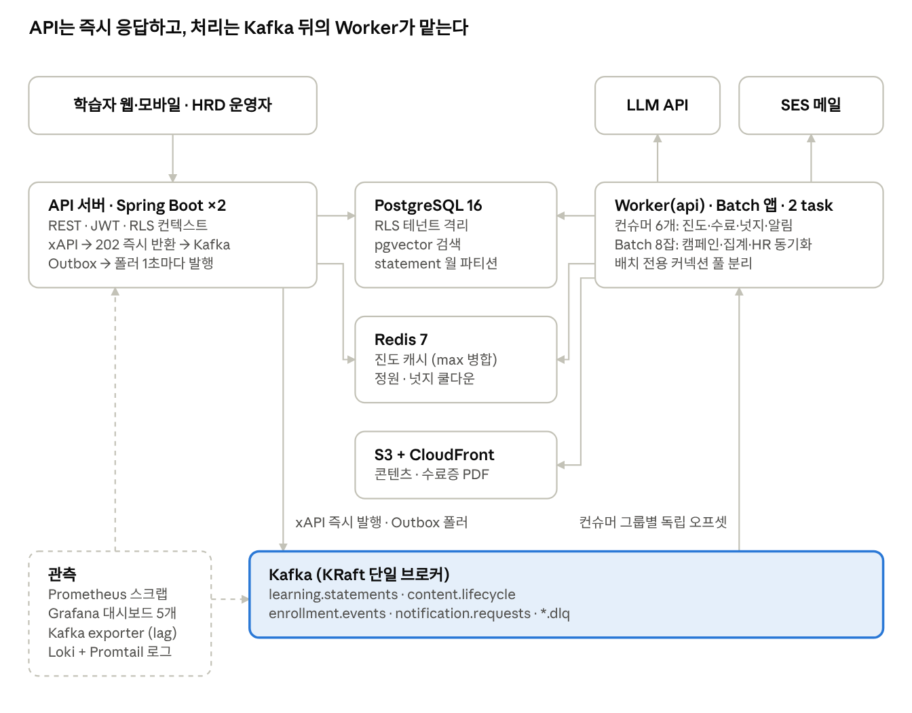
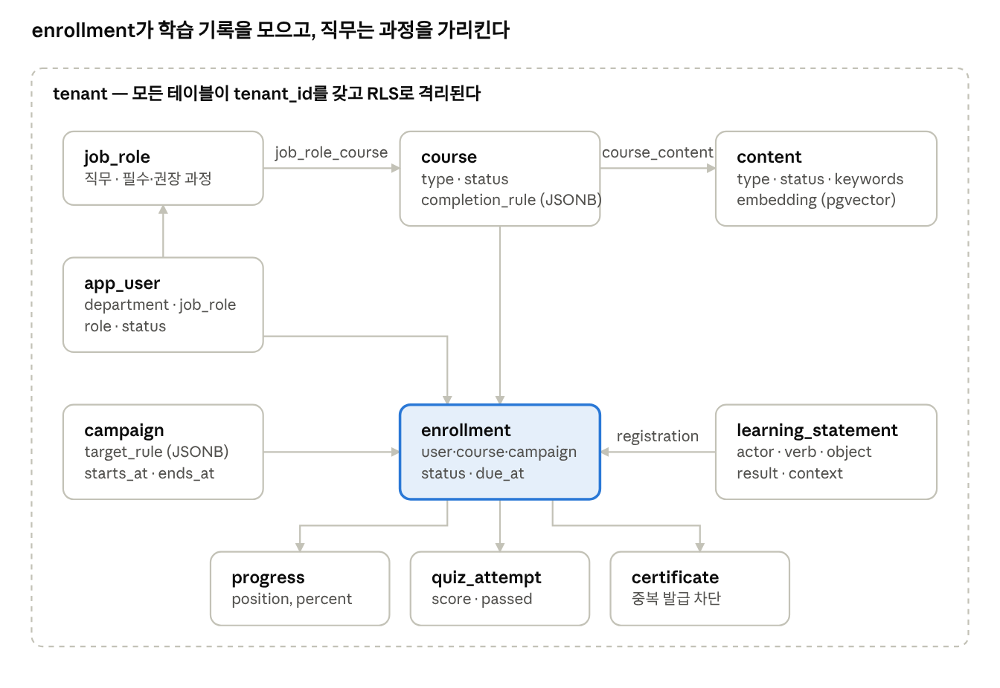
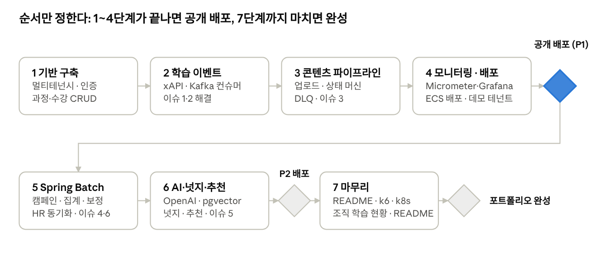

# 워크런(WorkLearn) — 기업 학습 플랫폼 기획서

Nov 3, 2026 · @홍예석

## 1. 프로젝트 개요

**워크런(WorkLearn)**은 현대오토에버 차세대 학습 플랫폼(NGLP)의 4개 모듈을 1인 개발 규모로 재현한 기업 학습 플랫폼이다. 핵심 설계 사상은 "학습 행동은 이벤트 스트림이다" — 이 한 문장이 Kafka부터 Spring Batch까지 모든 기술 선택의 근거가 된다.

### 목표

- Java/Spring 백엔드 역량을 실제 B2B 도메인(기업 교육 운영) 위에서 증명한다.
- 비동기 처리와 동시성 문제를 재현 → 측정 → 해결하는 과정을 커밋 히스토리와 Grafana 그래프로 남긴다.
- 교육학 전공 지식을 기능 설계의 근거로 사용해 "왜 이렇게 만들었는가"에 답한다.
- 공개 데모 테넌트를 운영해 실제 사용자 트래픽을 받는다.

* 트러블슈팅, 기술 결정 기록(ADR), 부하 테스트 리포트, 롤백 실험을 `worklearn-docs`에 모아 역량의 증거로 삼는다.

### 현대오토에버 NGLP와의 매핑

| NGLP 모듈 | NGLP 공식 설명 | 워크런 구현 범위 |
| --- | --- | --- |
| LXP | Onboarding\~Offboarding, 사용자 유형별 개인화, 학습 경험 분석 | xAPI 학습 이벤트 수집, 넛징카드, 직무 기반 추천 |
| LMS | Skill Based Learning, HRD 운영 도구, 법정 필수교육 위탁운영 | 과정·수강·이수 관리, 법정교육 캠페인, 수료증, 집체교육 정원 |
| CMS | 14가지 학습 자원, AI 메타데이터 자동 추출, UGC Shorts | 콘텐츠 업로드 파이프라인, LLM 메타데이터·요약 추출, pgvector 검색 |
| PMS | 테넌트·채널 독립 운영, AWS 글로벌 운영 | PostgreSQL RLS 기반 멀티테넌시, 테넌트별 설정, 플랫폼 운영 콘솔(테넌트 생성·정지·사용량), AWS 배포 |

### 지원 직무 연계

| 직무 | 이 프로젝트가 보여주는 것 |
| --- | --- |
| 엔터프라이즈IT Backend Developer | Java/Spring, JPA, RESTful API, 테스트 코드, Cloud Native, AWS |
| 생성형 AI Service Backend | LLM 메타데이터 추출, pgvector 자연어 검색, 비동기·캐싱·병렬 최적화 |
| 클라우드/인프라 모니터링 시스템 | Micrometer 커스텀 메트릭, Prometheus/Grafana 운영 대시보드 |

출처: [현대오토에버 차세대 학습 플랫폼](https://www.hyundai-autoever.com/kor/business-area/dx-solutions/nglp/contents.do?cntnSeq=443)

## 2. 핵심 기능 정의

5개 영역, 총 20개 기능으로 구성한다. 우선순위 P1은 MVP(공개 배포 시점) 필수, P2는 2차 배포, P3는 시간이 남을 때 추가한다.

### 2.1 CMS — 콘텐츠 파이프라인

| 기능 | 설명 | 우선순위 |
| --- | --- | --- |
| 콘텐츠 업로드 | 영상(mp4)·문서(pdf)·Shorts를 S3에 업로드. 상태 `UPLOADED → PROCESSING → REVIEW → READY / FAILED` 상태 머신으로 관리. 파이프라인은 항상 REVIEW에서 멈추고 운영자가 READY로 공개한다 | P1 |
| 비동기 처리 파이프라인 | 업로드 완료 이벤트 → 썸네일 생성, 텍스트 추출(pdf), 영상 길이 추출. 각 단계가 Kafka 컨슈머 | P1 |
| AI 메타데이터 추출 | 추출된 텍스트(영상·Shorts는 제목)를 LLM API(`gpt-4o-mini`)에 보내 키워드·요약·주제 태그 자동 생성(태그는 자유 생성, 운영자 검토). 임베딩(`text-embedding-3-small`, 1536)을 pgvector에 저장. 실패하면 메타데이터 없이 REVIEW에 두고 운영자가 입력·재처리 | P2 |
| 자연어 검색 | "쿠버네티스 입문" 같은 자연어 질의를 임베딩해 유사 콘텐츠 검색. 직무 기반 필터(내 직무의 필수·권장 과정 콘텐츠만) 결합. 결과는 콘텐츠 단위이며 소속 과정으로 이동 | P2 |
| 외부 자원 연계 | YouTube(youtube.com·youtu.be만 허용)를 링크형 콘텐츠로 등록(oEmbed 메타데이터만 수집, 진도는 IFrame API) | P3 |

### 2.2 LXP — 학습 경험

| 기능 | 설명 | 우선순위 |
| --- | --- | --- |
| 학습 이벤트 수집 | 시청 진도, 완료, 북마크, 평가, 검색을 xAPI statement로 수집해 Kafka에 발행 | P1 |
| 진도 추적 | 영상·문서 heartbeat(5초 간격)를 progress-writer 컨슈머가 Redis에 기록(max 병합), 60초마다 DB flush. API는 발행만 하고 진도를 쓰지 않는다 | P1 |
| 넛징카드 | 학습 중단 1·3·7일, 마감 D-3 같은 규칙으로 홈에 개인화 카드 노출(카드 = 미읽음 NUDGE·REMINDER 알림 최신 2건). 쿨다운으로 중복 방지 | P2 |
| 추천 | 직무별 권장 과정 + 같은 직무 동료의 수강 현황(소셜 프루프) + 유사 콘텐츠(임베딩) 기반 추천. 숙련도는 추정하지 않음 | P2 |

### 2.3 LMS — 학습 운영

| 기능 | 설명 | 우선순위 |
| --- | --- | --- |
| 과정·수강·이수 | 과정(여러 콘텐츠 묶음) 생성, 수강 신청, 진도+퀴즈 조건 충족 시 수료 처리 | P1 |
| 법정교육 캠페인 | 대상자 자동 선정, 마감 리마인더(D-7/D-3/D-1), 일별 이수율 집계, 미이수자 에스컬레이션 | P2 (공개 배포 이후 5단계) |
| 집체교육 정원 | 오프라인 과정 선착순 신청, 정원 초과 방지, 대기 명단(초과 시 WAITLISTED로 기록, 운영자가 정원을 늘리면 순서대로 승격). 일시·장소는 과정 설명에 적는다 | P2 |
| 수료증 | 수료 시 completion-judge가 PDFBox로 PDF 수료증 생성(S3). 중복 발급 방지 | P1 |
| HR 동기화 | HR CSV 업로드 시(데모 테넌트는 야간 mock 업로드 스크립트) 입사·퇴사·부서이동 반영, 온보딩 과정 자동 배정 | P2 |

### 2.4 PMS — 플랫폼 운영

| 기능 | 설명 | 우선순위 |
| --- | --- | --- |
| 멀티테넌시 | 회사(테넌트)별 데이터 격리. JWT에 tenant\_id, PostgreSQL RLS로 강제 | P1 |
| 테넌트 설정 | 필수교육 정책, 리마인더 주기, 수료 기준(진도 %·퀴즈 점수) | P2 |
| 테넌트 관리 콘솔 | 플랫폼 운영자(워크런 운영사)가 테넌트 생성·정지, 플랜 설정, 초기 관리자 초대. 생성은 비동기 프로비저닝 잡(직무 마스터·설정 시드 → 초대 메일) | P2 |
| 플랫폼 상태 | 전체 테넌트 횡단으로 컨슈머 lag, 배치 실행 결과, 실패 콘텐츠, 발송 실패를 한 화면에서 조회 | P2 |
| 테넌트별 사용량 | 학습자 수, 스토리지, LLM 호출 수를 statement-rollup의 사용량 Step이 일별 집계. 플랜 한도 초과 시 플랫폼 운영자 이메일 알림 + P1 목록 경고 배지 | P3 |

**플랜**은 기능 차이가 아니라 한도 차이다. 공개 가입을 받는 데모 테넌트와 실제 고객사를 구분하는 것이 목적이며, 한도는 `tenant_usage_daily`로 판정한다.

|  | DEMO | STANDARD |
| --- | --- | --- |
| 공개 가입 | 허용 | 불가 (HR 동기화·초대로만) |
| 학습자 상한 | 300명 (가입 시 검사) | 없음 |
| 스토리지 | 5 GB (업로드 시 검사) | 100 GB |
| 학습자 Shorts 업로드 | 불가 (HRD\_ADMIN만 업로드) | 허용 |
| LLM 호출 | 월 1,000 (추출 전 검사) | 월 10,000 |
| 학습 이력 보관 | 90일 (statement-rollup이 90일 지난 statement를 삭제. completed·passed는 보존) | 무기한 |

**프로비저닝 단계** (POST /platform/tenants → 202 → batch.commands → 잡 `tenant-provisioning`(10장)이 단계별 실행, 실패 시 완료 단계 건너뛰고 재시도)

1. 테넌트 레코드 생성, RLS 정책 동작 확인
2. 기본 설정 시드 — 수료 기준 90/70, 리마인더 D-7/3/1, 하루 2통·쿨다운 12시간
3. 직무 마스터 시드 — 플랫폼 기본 직무 15개(백엔드 개발, 프론트엔드 개발, 데이터 엔지니어링, 인프라·클라우드, 품질 보증, 제품 기획, 서비스 디자인, 데이터 분석, 영업, 마케팅, 고객 지원, 인사, 재무·회계, 구매·총무, 경영 지원. api 레포의 리소스 파일 하나를 시드 스크립트와 공유)를 테넌트에 복사. 부서는 시드하지 않고 HR CSV에서 자동 생성. `job_role_course`는 비워 둠
4. 초기 관리자 초대 — `app_user`(TENANT\_ADMIN, INVITED) 생성 + `invitation` 토큰 발급 + SES 메일. 수락 시 ACTIVE

### 2.5 분석 — 조직 학습 현황

| 기능 | 설명 | 우선순위 |
| --- | --- | --- |
| 조직 학습 현황 | 부서·직무별 이수율, 학습 시간, 인기 과정을 월별로 비교. 별도 배치 없이 일별 집계 테이블을 월 단위로 조회. 화면은 A1 운영 대시보드의 하위 섹션 | P3 |

공개 데모: 데모 테넌트 1개에 직접 제작한 Spring 입문 콘텐츠(CC 자료는 쓰지 않는다)를 올려 방문자가 간단 가입 후 수강하고 수료증을 받을 수 있게 한다. 방문자는 시청·퀴즈만 할 수 있고 운영자 화면은 열지 않는다. 이 트래픽이 Grafana 대시보드의 실제 데이터가 된다.

**CC 자료 선택 기준** (데모 콘텐츠를 공개 자료로 채울 경우)

- 라이선스: CC0, CC BY, CC BY-SA가 가장 안전. BY-NC(-SA)도 비영리 데모라 가능. **ND(변경금지)는 피한다** — LLM 요약·썸네일 생성이 2차 저작물로 해석될 수 있다.
- 획득 방식: 파일을 직접 내려받을 수 있는 출처(MIT OpenCourseWare 등)는 업로드형으로, YouTube의 CC 영상은 약관상 다운로드 대신 **링크형(임베드)** 콘텐츠로 등록한다. 두 타입 모두 `content.type`으로 구분한다.
- 표시: 모든 공개 자료는 `content.license`, `content.attribution`에 라이선스와 출처를 저장하고 화면에 노출한다.
- 한국어 자료: KOCW는 강의마다 CCL이 다르고 변경금지가 많으므로 강의별로 확인한다. 공공누리 1유형(출처표시) 자료와 위키백과(CC BY-SA)는 문서형으로 쓰기 좋다.
- 데모 테넌트는 광고·유료화 없이 비영리로 유지한다. SA 조건은 콘텐츠 2차 저작물에만 적용되고 플랫폼 코드 라이선스와는 무관하다.

## 3. 시스템 아키텍처

백엔드는 두 저장소로 나뉜다. `worklearn-api`는 REST API와 Kafka 컨슈머(`api`·`worker` 프로파일)를, `worklearn-batch`는 Spring Batch 잡을 담당한다. 세 프로세스가 같은 PostgreSQL·Redis·S3를 공유하고, DB 스키마는 api가 Flyway로 소유한다.



학습자의 xAPI 요청은 API에서 202로 끝나고, 진도 저장·수료 판정·넛지는 Kafka 뒤의 Worker가 처리한다. Worker만 LLM API와 SES를 호출하므로 외부 서비스 지연이 API 응답 시간에 섞이지 않는다. 관측 스택은 API와 Kafka를 스크랩해 모든 처리 지연을 Grafana에 보여준다.

## 4. 기술 선택 근거

면접에서 "왜 이 기술을 썼나요?"에 한 문장으로 답할 수 있어야 한다. 각 기술은 이 도메인의 구체적 요구에서 출발한다.

| 기술 | 이 도메인의 요구 | 대안과 선택 이유 |
| --- | --- | --- |
| Spring Boot 4.1 / Java 21 | 기업 LMS는 트랜잭션·감사·통합이 핵심인 전형적 엔터프라이즈 백엔드 | 현대오토에버 백엔드 공고 전체가 Java/Spring 기반. 3.x는 2026-06에 OSS 지원이 끝나 착수 시점(2026-11)에 지원이 살아 있는 4.1을 고른다(ADR-001) |
| PostgreSQL 16 | 수강·이수·수료는 법정 증빙 대상 트랜잭션 데이터. 테넌트 격리 필요 | RLS로 멀티테넌시를 DB 레벨에서 강제. pgvector 확장으로 벡터DB 없이 임베딩 검색. MySQL은 RLS·pgvector 부재 |
| Redis 7 | 영상 heartbeat는 5초 간격 write-heavy. 인기 랭킹·정원 카운터·넛지 쿨다운은 원자 연산 필요 | DB 직접 쓰기 시 커넥션 고갈. ZSET·INCR·SET NX가 요구와 1:1 대응 |
| Kafka | 학습 이벤트 1건을 진도 저장·추천 갱신·넛지 판정·분석 적재 4곳이 소비. 콘텐츠 처리는 단계별 재시도 필요 | RabbitMQ는 이벤트 재생(replay)과 컨슈머 그룹별 독립 오프셋이 약함. 파티션 키로 사용자별 순서 보장 |
| Spring Batch 6 | 전 직원 대상 캠페인 배정, 일별 집계, HR 파일 동기화 — 대량·정기·재시작 가능해야 함 | `@Scheduled` 단독은 실패 지점 재시작·처리 건수 추적 불가. 청크 단위 커밋과 JobRepository가 필요 |
| Micrometer + Actuator | 커스텀 메트릭(진도 이벤트 처리량, 넛지 발송률)을 코드에서 직접 정의 | Actuator가 Micrometer를 내장. `micrometer-registry-prometheus` 추가만으로 `/actuator/prometheus` 노출 |
| Prometheus + Grafana | 동시성 개선 전후를 그래프로 증명. 운영 대시보드가 곧 PMS 기능 | 시계열 수집·시각화 사실상 표준. Loki 추가 시 로그까지 통합 |
| Docker Compose | Kafka·Redis·Postgres·Prometheus·Grafana를 로컬에서 한 번에 | 부하 테스트 재현성 |
| AWS | NGLP의 "글로벌 운영(AWS Cloud)". 현대오토에버는 AWS 프리미어 티어 파트너 | S3(콘텐츠), SES(리마인더), RDS, ElastiCache, ECS |
| LLM API (OpenAI) | 콘텐츠 메타데이터·요약·주제 태그 자동 추출 | NGLP의 "AI 기반 Metadata 자동 추출/요약" 재현. 자체 모델 학습은 범위 밖. 개발 보조 AI(Claude)와 공급자를 분리해 비용·호출 기록을 구분 |

### 쓰지 않기로 한 것

- **MongoDB**: xAPI statement는 JSON이라 MongoDB가 자연스럽지만, 기술 스택을 늘리지 않기 위해 PostgreSQL JSONB 컬럼으로 대체한다.
- **영상 트랜스코딩**: FFmpeg 파이프라인은 범위를 잡아먹는다. 썸네일·길이 추출까지만 한다.

## 5. 도메인 모델 및 테이블 설계

모든 업무 테이블은 `tenant_id`를 가지며 PostgreSQL RLS 정책으로 격리한다. 학습 이벤트(`learning_statement`)만 월 단위 파티셔닝하고, 나머지는 일반 테이블이다.

모든 테이블은 `created_at`·`updated_at`을 가지고, 업무 테이블은 모두 `tenant_id`를 가진다(아래 표에서는 둘 다 생략). RLS 밖 테이블은 `tenant`(레지스트리), `platform_user`, `platform_audit`, `outbox`, `processed_event`, `tenant_usage_daily`, `batch_meta.*`뿐이다. 화면의 "최근 업데이트", "3일 전에 멈췄어요" 같은 표시는 이 컬럼에서 나온다.



`enrollment`가 중심이다: 사용자·과정·캠페인을 묶는 학습 기록의 허브로, 진도·퀴즈·수료증이 모두 여기에 매달린다. 직무(`job_role`)는 `job_role_course`로 필수·권장 과정을 가리키고, 콘텐츠의 주제 태그는 `content.keywords`에 둔다. 숙련도(스킬 레벨) 개념은 두지 않는다 — 시청·수료 이력은 숙련도의 증거가 아니기 때문이다. 인프라용 테이블(`outbox`, `processed_event`, `campaign_daily_stat`)과 집계·부가 테이블(quiz, bookmark, notification, content\_stat, course\_peer\_stat 등)은 그림에서 제외했다.

### 테이블 정의

| 테이블 | 핵심 컬럼 | 설계 포인트 |
| --- | --- | --- |
| `tenant` | id, slug, name, plan, status, provisioning\_step, settings(JSONB) | settings에 수료 기준·리마인더 주기·public\_signup·branding 등 테넌트 정책. status = PROVISIONING / ACTIVE / SUSPENDED. plan = DEMO / STANDARD (한도는 2.4 플랜 표). RLS 밖(테넌트 레지스트리). 일반 API는 JWT의 tenant\_id로만 조회한다 |
| `app_user` | id, tenant\_id, email, name, role, department\_id, job\_role\_id, status, hired\_at, left\_at | HR 동기화 대상. role = LEARNER / HRD\_ADMIN / TENANT\_ADMIN. status = INVITED / ACTIVE / LEFT |
| `department` | id, tenant\_id, name, parent\_id, manager\_user\_id | 부서 트리. 이수율·학습 시간 집계 단위. manager\_user\_id가 마감 후 에스컬레이션 수신자 |
| `job_role` | id, tenant\_id, name | 직무. `job_role_course`로 필수·권장 과정 연결 |
| `content` | id, tenant\_id, type, title, s3\_key, status, pipeline\_stage, failure\_reason, reviewed\_at, thumbnail\_key, text\_key, duration\_sec, page\_count, summary, keywords(text\[\]), embedding(vector 1536), license, attribution, created\_by | status = UPLOADED / PROCESSING / REVIEW / READY / FAILED. 파이프라인은 항상 REVIEW에서 멈추고 운영자가 READY로 공개한다. type = VIDEO / DOCUMENT / SHORTS / LINK. 영상은 duration\_sec, 문서는 page\_count. text\_key는 추출 텍스트의 S3 사이드카 키. embedding은 pgvector(6단계에 컬럼 추가). 썸네일은 공개 경로, 원본은 presigned(2시간). license·attribution으로 CC 자료 출처 표시 |
| `course` | id, tenant\_id, title, description, type, status, cover\_key, capacity, completion\_rule(JSONB) | type = ONLINE / OFFLINE. status = DRAFT / PUBLISHED (DRAFT는 학습자에게 안 보임). completion\_rule = {progress: 90, quiz: 70}(생성 시 테넌트 기본값 복사, 소급 없음). 과정의 주제 태그는 포함 콘텐츠 keywords의 합집합으로 계산. 집체교육 일시·장소는 description에 적는다(별도 컬럼 없음). capacity를 늘리면 WAITLISTED를 created\_at 순으로 승격 |
| `course_content` | course\_id, content\_id, sort\_order | 과정 내 콘텐츠 순서 |
| `campaign` | id, tenant\_id, course\_id, name, target\_rule(JSONB), reminder\_rule(JSONB), starts\_at, ends\_at, status | target\_rule = {all, departments\[\], job\_roles\[\], auto\_enroll\_new\_hires}. reminder\_rule = {days\_before: \[7,3,1\], escalate: true}. status = DRAFT / ACTIVE / CLOSED |
| `enrollment` | id, tenant\_id, user\_id, course\_id, campaign\_id, source, status, due\_at, completed\_at | UNIQUE(user\_id, course\_id, campaign\_id). source = CAMPAIGN / SELF / ONBOARDING. status = ENROLLED → IN\_PROGRESS(첫 progressed) → COMPLETED, 그 밖에 EXPIRED(캠페인 마감), CANCELLED(퇴사 해제), WAITLISTED(정원 대기) |
| `progress` | enrollment\_id, content\_id, position\_sec, percent, last\_seen\_at | UNIQUE(enrollment\_id, content\_id). Redis flush 대상 |
| `quiz_attempt` | id, enrollment\_id, quiz\_id, score, passed, answers(JSONB), attempted\_at | 수료 조건의 두 번째 축 |
| `certificate` | id, enrollment\_id, pdf\_s3\_key, issued\_at | UNIQUE(enrollment\_id)로 중복 발급 차단 |
| `campaign_daily_stat` | campaign\_id, stat\_date, department\_id, target\_cnt, completed\_cnt | 배치가 매일 생성. 대시보드는 이 테이블만 조회 |
| `learning_statement` | id, tenant\_id, actor\_id, verb, object\_type, object\_id, result(JSONB), context(JSONB), occurred\_at, stored\_at | xAPI raw. `occurred_at` 기준 월 파티션(Flyway가 24개월분 선생성, statement-rollup이 다음 달 것을 보충). 보존은 플랜 기준으로 행을 삭제하며 파티션은 drop하지 않는다 |
| `nudge_log` | id, user\_id, rule\_key, sent\_at, channel, status, error | 리마인더·넛지 발송 이력. status = SENT / FAILED. 중복 방지 근거 |
| `processed_event` | event\_id, consumer\_group, processed\_at | 컨슈머 멱등 처리. UNIQUE(event\_id, consumer\_group). RLS 밖 |
| `outbox` | id, aggregate\_type, aggregate\_id, event\_type, payload(JSONB), published\_at | Transactional Outbox. worker의 폴러가 `SKIP LOCKED`로 읽어 event\_type에 따라 토픽을 골라 발행. 배치도 이 표로만 발행한다. RLS 밖 |
| `tenant_usage_daily` | tenant\_id, stat\_date, learner\_cnt, storage\_bytes, llm\_calls, statement\_cnt | 배치가 일별 생성. 플랫폼 콘솔 사용량·플랜 한도 판정. RLS 밖(플랫폼 운영자만 조회) |
| `quiz` | id, tenant\_id, course\_id, title, pass\_score, time\_limit\_min | 과정당 1개. pass\_score는 completion\_rule.quiz와 동일하게 유지 |
| `quiz_question` | id, quiz\_id, sort\_order, body, choices(JSONB), answer\_index, explanation | 객관식만. answer\_index는 학습자 API 응답에서 제외 |
| `bookmark` | user\_id, content\_id, created\_at | UNIQUE(user\_id, content\_id). bookmarked statement도 함께 발행 |
| `notification` | id, tenant\_id, user\_id, type, title, body, link, read\_at | 인앱 알림함. notifier 컨슈머가 이메일 발송과 함께 INSERT. nudge\_log는 발송 이력, 이 테이블은 사용자가 보는 함 |
| `daily_learning_stat` | tenant\_id, user\_id, stat\_date, learning\_sec, completed\_cnt | statement-rollup 배치가 생성. 홈 "이번 주 1시간 20분", 마이페이지 "18h" |
| `content_stat` | content\_id, view\_cnt, completion\_cnt, rating\_avg, rating\_cnt | launched·completed·rated statement를 배치가 집계. 탐색·추천의 "동료 42명 시청 · 4.8" |
| `course_peer_stat` | course\_id, job\_role\_id, completed\_cnt, total\_cnt, stat\_date | 과정 × 직무 이수율. 과정 상세·넛지의 "같은 직무 동료 73%". 캠페인 밖 자가 수강 과정도 포함 |
| `platform_audit` | id, actor\_id, action, target\_tenant\_id, payload(JSONB), occurred\_at | 플랫폼 운영자의 모든 호출 기록. RLS 밖 |
| `platform_user` | id, email, password\_hash | PLATFORM\_ADMIN 계정. 테넌트가 없으므로 app\_user와 분리. api 기동 시 환경변수(`PLATFORM_ADMIN_EMAIL`·`PLATFORM_ADMIN_PASSWORD`)로 없을 때만 1개 생성. RLS 밖 |
| `hr_sync_run` | id, tenant\_id, file\_key, job\_execution\_id, total\_rows, created\_cnt, left\_cnt, moved\_cnt, skipped\_cnt, status | HR CSV 1회 업로드 = 1행. 화면의 "신규 12 · 퇴사 3 · 이동 7" 출처 |
| `hr_sync_skip` | run\_id, row\_no, raw(JSONB), reason | 배치 skip 정책이 남기는 행. 10장의 skip\_log가 이것 |
| `job_role_course` | job\_role\_id, course\_id, kind, sort\_order | kind = REQUIRED / RECOMMENDED. 온보딩·직무 이동 시 REQUIRED 자동 배정, 홈 추천은 RECOMMENDED + 동료 수강 현황 |
| `invitation` | token, tenant\_id, user\_id, expires\_at, accepted\_at | 초기 관리자 초대. 일회용, 7일 만료, 재발송 시 새 토큰. 수락하면 app\_user.status INVITED → ACTIVE |

### RLS 정책 예시

```sql
ALTER TABLE enrollment ENABLE ROW LEVEL SECURITY;
CREATE POLICY tenant_isolation ON enrollment
  USING (tenant_id = current_setting('app.tenant_id')::uuid);
```

애플리케이션은 커넥션을 빌릴 때 `SET LOCAL app.tenant_id = ?`를 실행한다. JPA 레벨 필터를 깜빡해도 DB가 막는다.

플랫폼 운영자 API는 테넌트를 횡단해야 하므로 RLS를 우회하는 별도 DB 롤(`BYPASSRLS`)과 별도 커넥션 풀을 쓴다. 이 롤은 `/platform/**` 경로에서만 사용하고 모든 호출을 감사 로그(`platform_audit`)에 남긴다. 일반 API 코드에서 이 롤에 접근할 수 없게 빈 설정 자체를 모듈로 분리한다. 배치는 이 롤을 쓰지 않는다. 모든 잡은 테넌트별 Step 안에서 `SET LOCAL`을 실행해 RLS 아래에서 돈다.

## 6. xAPI 학습 이벤트 스키마

학습 행동은 xAPI(Experience API) statement 형식을 따른다. "누가(actor) — 무엇을 했다(verb) — 무엇에(object) — 결과는(result) — 맥락은(context)" 구조라서 완료율만이 아니라 학습 과정 전체를 측정할 수 있다. 업계 표준을 쓰면 외부 LRS(Learning Record Store)나 다른 LMS와의 연계도 열려 있다는 점을 어필할 수 있다.

### Statement 구조

```json
{
  "id": "6d1c2a3e-...",
  "actor": { "account": { "homePage": "https://worklearn.dev/t/demo", "name": "user-1042" } },
  "verb": { "id": "http://adlnet.gov/expapi/verbs/progressed", "display": { "ko": "진행함" } },
  "object": {
    "id": "https://worklearn.dev/content/c-88",
    "definition": { "type": "http://adlnet.gov/expapi/activities/media", "name": { "ko": "Spring Bean 생명주기" } }
  },
  "result": { "extensions": { "https://worklearn.dev/ext/position": 342, "https://worklearn.dev/ext/percent": 57 } },
  "context": {
    "registration": "enrollment-5531",
    "platform": "web",
    "extensions": { "https://worklearn.dev/ext/tenant": "demo", "https://worklearn.dev/ext/device": "d-9a1" }
  },
  "timestamp": "2026-11-03T05:12:41Z"
}
```

`context.registration`이 enrollment를 가리키고, `context.extensions.device`가 기기 간 진도 병합의 근거가 된다.

### 사용 Verb 목록

| Verb | 발생 시점 | result에 담는 값 | 소비하는 컨슈머 |
| --- | --- | --- | --- |
| `launched` | 콘텐츠 재생 시작 | — | 분석 적재 |
| `progressed` | 영상·문서 모두 5초 heartbeat(문서는 position = 페이지, percent = 최대 도달 페이지 / page\_count), 페이지 이동 시 즉시 1건 | position, percent | 진도 저장, 넛지 판정 |
| `completed` | 콘텐츠 진도가 과정 수료 기준(completion\_rule.progress)에 처음 도달. 클라이언트가 아니라 progress-writer가 서버에서 발행한다 | percent, duration | 수료 판정, 추천 갱신, 수료 알림 |
| `answered` | 퀴즈 제출 | score, success | 수료 판정 |
| `passed` / `failed` | 과정 수료 조건 최종 판정 | score | 수료증 발급, 분석 |
| `bookmarked` | 북마크 추가 | — | 추천 갱신 |
| `rated` | 콘텐츠 완료 시 플레이어의 별점(클라이언트가 발행, 별도 평가 API 없음) | score(1\~5) | 소셜 프루프 집계 |
| `searched` | 검색 실행(API가 발행) | response(검색어) | 분석 적재, 검색 품질 |
| `registered` | 캠페인·온보딩·자가 수강 배정(자가 수강은 API가 직접, 캠페인·온보딩은 배치가 Outbox로 발행) | — | 분석 적재 |

### 저장 전략

- 모든 statement는 Kafka `learning.statements` 토픽에 발행되고, 분석 컨슈머가 `learning_statement` 테이블(월 파티션)에 그대로 적재한다. API는 검증 후 Outbox 없이 직접 발행하며, 진도·수료 어떤 처리도 요청 안에서 하지 않는다.
- 보존은 플랜 기준이다(2.4 플랜 표). DEMO는 90일 지난 statement를 statement-rollup이 삭제하되 `completed`·`passed`는 남기고, STANDARD는 무기한 보관한다. 월 파티션은 관리 단위일 뿐 drop하지 않는다.
- statement `id`는 클라이언트가 UUID로 생성한다. 네트워크 재전송으로 같은 id가 두 번 오면 `processed_event` 테이블이 걸러낸다.
- 학습 시간은 그날의 `progressed` 건수 × 5초로 계산한다(영상·문서 공통).

## 7. Kafka 토픽 및 컨슈머 설계

토픽 4개, 컨슈머 그룹 6개로 시작한다. 파티션 키는 "순서가 지켜져야 하는 단위"로 정한다 — 학습 이벤트는 사용자, 콘텐츠 처리는 콘텐츠. 토픽은 api 앱이 기동 시 `KafkaAdmin`·`NewTopic`으로 만든다(브로커 auto-create 비활성).

### 토픽

| 토픽 | 파티션 키 | 파티션 수 | 보존 | 발행 주체 |
| --- | --- | --- | --- | --- |
| `learning.statements` | `tenant_id:actor_id` | 6 | 7일 | API 서버 (xAPI 수신 즉시) |
| `content.lifecycle` | `content_id` | 3 | 7일 | Outbox 폴러 (상태 변경 시) |
| `enrollment.events` | `tenant_id:user_id` | 3 | 7일 | Outbox 폴러 (배정·수료·만료) |
| `notification.requests` | `user_id` | 3 | 3일 | worker(넛지 판정·지연 큐는 직접), 배치 리마인더(Outbox 폴러) |
| `*.dlq` | 원본과 동일 | 1 | 30일 | 각 컨슈머의 실패 메시지 |
| `batch.commands` | `tenant_id` | 1 | 7일 | API (캠페인 launch 등 수동 잡 요청) → batch 앱이 소비해 잡 실행 |

### 컨슈머 그룹

| 컨슈머 그룹 | 구독 토픽 | 역할 | 멱등 처리 |
| --- | --- | --- | --- |
| `progress-writer` | learning.statements (progressed) | Redis HSET으로 진도 갱신(max 병합). 60초마다 dirty set을 DB flush. 첫 progressed에서 enrollment를 IN\_PROGRESS로 바꾸고, 콘텐츠 진도가 과정 수료 기준에 처음 도달하면 `completed`를 발행 | Redis max 연산 자체가 멱등 |
| `completion-judge` | learning.statements (completed, answered) | enrollment별 진도·퀴즈 조건 확인 → 충족 시 수료 처리 + certificate 생성 + PDF 수료증(S3) 생성 | `processed_event` + certificate UNIQUE |
| `nudge-evaluator` | learning.statements (progressed, completed) | 마지막 학습 시각을 갱신하고 Redis ZSET 지연 큐에 "다음 중단 점검"(1·3·7일)을 예약. worker 스케줄러가 만기 항목을 평가해 여전히 중단 상태면 notification.requests 발행 | 쿨다운은 notifier가 적용 |
| `statement-archiver` | learning.statements (전체) | `learning_statement` 테이블 적재 | statement id UNIQUE |
| `content-processor` | content.lifecycle (UPLOADED, REPROCESS) | 썸네일·길이(ffprobe/ffmpeg)·텍스트(PDFBox, S3 사이드카) 추출 → PROCESSING → LLM 메타데이터 → REVIEW(운영자가 READY로 공개) | 상태 머신 전이 검증(완료 단계 skip) |
| `notifier` | notification.requests | 발송 전 Redis 쿨다운(12시간, 하루 2통) 확인 → 이메일(SES)·인앱 알림 발송, 억제되면 Redis ZSET 지연 큐. enrollment.events의 배정·수료 이벤트도 구독해 알림함에 기록(인앱만), `nudge_log` 기록(실패는 status = FAILED) | `nudge_log` UNIQUE(user\_id, rule\_key, date) + 쿨다운 키 |

### 발행 측 정합성 — Transactional Outbox

`enrollment.events`와 `content.lifecycle`은 DB 상태 변경과 이벤트 발행이 반드시 함께 일어나야 한다. "DB 커밋 성공, Kafka 발행 실패"가 생기면 수료했는데 수료증이 안 나오는 상황이 된다.

1. 서비스가 enrollment 상태를 바꾸는 트랜잭션 안에서 `outbox` 테이블에 이벤트 row를 함께 INSERT한다.
2. 별도 폴러(`@Scheduled` 1초)가 `published_at IS NULL`인 row를 읽어 Kafka로 발행하고 `published_at`을 채운다.
3. 폴러가 발행 후 `published_at` 갱신 전에 죽으면 같은 이벤트가 두 번 나간다 → 컨슈머 멱등 처리가 이를 흡수한다(at-least-once).

`learning.statements`는 양이 많고 1건 유실이 치명적이지 않으므로 Outbox 없이 API에서 직접 발행한다(`acks=all`). 이 차이를 설명할 수 있어야 한다.

배치(`worklearn-batch`)는 Kafka producer를 갖지 않는다. 배정·만료 이벤트, 리마인더 요청, `registered` statement처럼 배치가 내는 것은 모두 `outbox` 행으로 쓰고, worker의 폴러가 `event_type`에 따라 토픽을 골라 발행한다. 폴러는 인스턴스가 여럿이어도 `SELECT ... FOR UPDATE SKIP LOCKED`로 겹치지 않게 읽는다. 이벤트 계약(JSON Schema)은 api 레포에 있고 검증은 api의 수신 지점과 폴러에서만 한다. 배치는 아래 payload 표를 따라 쓰기만 한다.

| event\_type | 토픽 | payload 필수 필드 |
| --- | --- | --- |
| `enrollment.assigned` / `enrollment.completed` / `enrollment.expired` | enrollment.events | tenant\_id, user\_id, enrollment\_id, course\_id, campaign\_id |
| `content.uploaded` / `content.reprocess` | content.lifecycle | tenant\_id, content\_id |
| `notification.request` | notification.requests | tenant\_id, user\_id, rule\_key, channel\[\], title, body, link, priority |
| `statement` | learning.statements | xAPI statement 본문 그대로 |

### 실패 처리

- 컨슈머는 수동 ack. 처리 실패 시 3회 재시도(지수 백오프) 후 `*.dlq`로 이동.
- DLQ는 플랫폼 운영자가 `POST /platform/dlq-replay`로 Spring Batch 잡 `dlq-replay`를 띄워 재처리한다.
- 컨슈머 lag는 Kafka exporter → Prometheus로 수집해 Grafana 알람(lag > 1,000)을 건다.

## 8. API 목록

REST, JSON, 모든 경로에 `/api/v1` 접두사. 인증은 JWT(Bearer)이며 토큰에 `tenant_id`·`role`을 담는다. 역할은 LEARNER / HRD\_ADMIN / TENANT\_ADMIN / PLATFORM\_ADMIN 네 가지다. PLATFORM\_ADMIN은 특정 테넌트에 속하지 않는 워크런 운영사 계정(`platform_user` 테이블)으로, JWT에 tenant\_id가 없고 \`/platform/\*\*\`만 호출할 수 있다.

JWT는 24시간 만료이고 리프레시 토큰은 없다(만료 시 재로그인). 보호된 요청마다 테넌트 상태(Redis 캐시)를 확인해 SUSPENDED면 401이다. 웹은 JWT를 httpOnly 쿠키에 두고 브라우저·서버 컴포넌트 모두 Next.js 라우트 핸들러를 거쳐 API를 호출하며, 페이지 경로는 `/t/{slug}/...`다.

### 인증·테넌트

| 메서드 | 경로 | 설명 | 역할 |
| --- | --- | --- | --- |
| POST | `/auth/signup` | 데모 테넌트 이메일·비밀번호 가입 (이메일 인증 없음). body: tenant\_slug, email, password(8자 이상), name, job\_role\_id(필수). tenant.settings.public\_signup이 true인 테넌트만 | 공개 |
| POST | `/auth/login` | 로그인, JWT 발급. body: tenant\_slug, email, password | 공개 |
| GET | `/job-roles?tenant_slug=` | 가입 화면의 직무 선택 목록. public\_signup 테넌트만 | 공개 |
| GET | `/tenants/me` | 현재 테넌트 설정 조회 | 전체 |
| PATCH | `/tenants/me/settings` | 수료 기준·리마인더 정책 변경 | TENANT\_ADMIN |
| POST | `/auth/accept-invite` | 초대 토큰 + 비밀번호로 계정 활성화. 토큰은 한 번만 사용 | 공개 |

### CMS

| 메서드 | 경로 | 설명 | 역할 |
| --- | --- | --- | --- |
| POST | `/contents/upload-url` | S3 presigned PUT URL 발급(15분). 허용 mp4·pdf, 상한 VIDEO 2 GB · SHORTS 200 MB · DOCUMENT 50 MB | HRD\_ADMIN, LEARNER(Shorts만, DEMO 플랜은 불가) |
| POST | `/contents` | 업로드 완료 통보 → UPLOADED 상태 생성, 파이프라인 시작. type = LINK는 url만 받고 S3 없이 등록(7단계) | 동일 |
| GET | `/contents/{id}` | 콘텐츠 상세(상태, 메타데이터, 주제 태그) | 전체 |
| GET | `/contents/search?q=&tag=&type=&job_role=` | 1차 키워드(tsvector `simple`) → 6단계 자연어(pgvector) 검색. 결과는 READY이고 PUBLISHED 과정에 포함된 콘텐츠만, 소속 과정(id·title) 포함 | 전체 |
| GET | `/contents/{id}/stream-url` | 재생용 presigned URL(2시간). 썸네일은 공개 경로 | 전체 |
| GET | `/contents?status=&type=&page=` | 운영자용 콘텐츠 목록. 상태별 건수 포함 | HRD\_ADMIN |
| PATCH | `/contents/{id}` | 요약·키워드·주제 태그·라이선스·출처 수정. REVIEW → READY 전이(검토 완료·공개) | HRD\_ADMIN |
| POST | `/contents/{id}/reprocess` | 실패·검토 중 콘텐츠를 파이프라인에 다시 넣음. 완료된 단계는 건너뜀 | HRD\_ADMIN |

### LXP — 학습 이벤트·진도

| 메서드 | 경로 | 설명 | 역할 |
| --- | --- | --- | --- |
| POST | `/xapi/statements` | xAPI statement 수신(배열 허용). 202 Accepted 즉시 반환 | LEARNER |
| GET | `/me/progress/{contentId}` | 마지막 시청 위치(Redis 우선, 없으면 DB) | LEARNER |
| GET | `/me/home` | 학습 이어하기 + 진행 중 과정 + 넛징카드(미읽음 NUDGE·REMINDER 알림 최신 2건) + 필수교육 D-day + 추천 | LEARNER |
| POST | `/me/bookmarks/{contentId}` | 북마크 | LEARNER |
| GET / DELETE | `/me/bookmarks, /me/bookmarks/{contentId}` | 북마크 목록·해제 | LEARNER |
| GET | `/me/job-role-courses` | 내 직무의 필수·권장 과정과 수강 상태(마이페이지 체크리스트) | LEARNER |
| GET | `/me/notifications?unread=` | 인앱 알림함. 홈 종 아이콘의 읽지 않은 수 | LEARNER |
| PATCH | `/me/notifications/{id}/read` | 읽음 처리 | LEARNER |

### LMS — 과정·수강·캠페인

| 메서드 | 경로 | 설명 | 역할 |
| --- | --- | --- | --- |
| POST | `/courses` | 과정 생성 | HRD\_ADMIN |
| GET | `/courses?status=&page=` | 과정 목록. HRD\_ADMIN은 전체, LEARNER는 PUBLISHED만 | 전체 |
| GET | `/courses/{id}` | 과정 상세 + 소셜 프루프(동료 이수율) | 전체 |
| POST | `/courses/{id}/enroll` | 자가 수강 신청(`registered` 발행). OFFLINE은 정원 검사, 초과 시 WAITLISTED. 수강 취소 API는 없다 | LEARNER |
| GET | `/me/enrollments` | 내 수강 목록·상태(certificate\_ready 포함) | LEARNER |
| POST | `/enrollments/{id}/quiz` | 퀴즈 제출 → 서버 채점 → `answered` statement 발행. 재응시 무제한, 제한 시간은 클라이언트 타이머 | LEARNER |
| GET | `/enrollments/{id}/certificate` | 수료증 PDF 다운로드 URL. 아직 생성 전이면 404 | LEARNER |
| POST | `/campaigns` | 법정교육 캠페인 생성 (대상 규칙 포함) | HRD\_ADMIN |
| GET | `/campaigns?status=` | 캠페인 목록 | HRD\_ADMIN |
| GET | `/campaigns/{id}` | 캠페인 상세 | HRD\_ADMIN |
| POST | `/campaigns/{id}/launch` | 대상자 선정 배치 트리거. 요청 시 ACTIVE로 전이, 202 | HRD\_ADMIN |
| GET | `/campaigns/{id}/stats?date=` | 캠페인 이수율(일별 집계 테이블) | HRD\_ADMIN |
| GET | `/campaigns/{id}/incomplete` | 미이수자 명단 (CSV 다운로드) | HRD\_ADMIN |
| GET | `/courses/{id}/quiz` | 퀴즈 문항·보기 조회 (정답 제외) | LEARNER |
| POST | `/campaigns/preview-targets` | target\_rule을 받아 대상자 수와 부서별 분포만 계산 (배정하지 않음) | HRD\_ADMIN |
| PATCH | `/courses/{id}` | 제목·설명·유형·정원·수료 조건·status(DRAFT ↔ PUBLISHED) 수정. 정원을 늘리면 대기자를 순서대로 승격 | HRD\_ADMIN |
| PUT | `/courses/{id}/contents` | 콘텐츠 목록과 순서를 통째로 교체 (course\_content 재작성). READY 콘텐츠만 허용 | HRD\_ADMIN |
| PUT | `/courses/{id}/quiz` | 퀴즈 문항·보기·정답·통과 점수·제한 시간 저장 | HRD\_ADMIN |

### 운영·관리

| 메서드 | 경로 | 설명 | 역할 |
| --- | --- | --- | --- |
| POST | `/admin/hr-sync` | HR CSV 업로드 → 동기화 배치 트리거 | TENANT\_ADMIN |
| GET | `/admin/jobs` | 배치 잡 실행 이력 | TENANT\_ADMIN |
| POST | `/admin/jobs/{executionId}/restart` | 실패 잡 재시작 | TENANT\_ADMIN |
| GET | `/actuator/prometheus` | 메트릭 노출 (내부망만) | — |
| GET | `/admin/hr-sync/runs` | 최근 동기화 결과(hr\_sync\_run)와 건너뛴 행 CSV 링크 | TENANT\_ADMIN |
| GET / PATCH | `/admin/users?role=, /admin/users/{id}/role` | 운영자 권한 조회·부여 (HRD\_ADMIN, TENANT\_ADMIN). 자기 자신 강등 불가 | TENANT\_ADMIN |
| GET | `/admin/dashboard` | A1 KPI 4개(활성 학습자 = 최근 30일 progress.last\_seen\_at 기준, 수강 중, 수료, 수료율)와 전주 대비 증감 | HRD\_ADMIN, TENANT\_ADMIN |
| GET | `/admin/dashboard/org?month=` | 조직 학습 현황(부서·직무별 이수율·학습 시간·인기 과정). 7단계 | HRD\_ADMIN, TENANT\_ADMIN |

### 플랫폼 운영 (PLATFORM\_ADMIN 전용)

| 메서드 | 경로 | 설명 | 역할 |
| --- | --- | --- | --- |
| GET | `/platform/tenants` | 테넌트 목록 (플랜, 상태, 학습자 수, 생성일) | PLATFORM\_ADMIN |
| POST | `/platform/tenants` | 테넌트 생성 → PROVISIONING 상태로 저장 후 프로비저닝 잡 발행. 202 반환 | PLATFORM\_ADMIN |
| GET | `/platform/tenants/{id}` | 테넌트 상세 + 프로비저닝 단계 진행 상황 | PLATFORM\_ADMIN |
| PATCH | `/platform/tenants/{id}/status` | ACTIVE ↔ SUSPENDED 전환. 정지 시 해당 테넌트 로그인·배치 중단 | PLATFORM\_ADMIN |
| POST | `/platform/tenants/{id}/admins` | 초기 TENANT\_ADMIN 초대 메일 발송 | PLATFORM\_ADMIN |
| GET | `/platform/tenants/{id}/usage?from=&to=` | 일별 사용량 (`tenant_usage_daily`) | PLATFORM\_ADMIN |
| GET | `/platform/health` | 테넌트 횡단 상태: 컨슈머 lag(Prometheus API를 질의해 반환), 최근 배치 결과(JobRepository), 실패 콘텐츠·발송 수 | PLATFORM\_ADMIN |
| GET | `/platform/jobs?tenant=` | 전체 배치 실행 이력, 테넌트 필터 | PLATFORM\_ADMIN |
| POST | `/platform/dlq-replay` | DLQ 토픽을 지정해 `dlq-replay` 잡 실행 | PLATFORM\_ADMIN |

`POST /xapi/statements`가 202를 즉시 반환하고 실제 처리는 Kafka 컨슈머가 하는 것, 그리고 `POST /courses/{id}/enroll`의 정원 검사가 동시성 이슈의 두 중심이다.

## 9. 동시성·비동기 이슈와 해결 전략

6가지 이슈를 다룬다. 각 이슈는 **재현 테스트 → 측정 → 단계적 개선** 순서로 진행하고, 단계마다 커밋과 Grafana 스크린샷을 남긴다. 처음부터 정답을 구현하지 않는 것이 핵심이다.

### 이슈 1. 진도율 정합성 (기기 간 동시 시청)

**문제**: 같은 사용자가 PC(57%)와 모바일(43%)에서 같은 영상을 보면 heartbeat가 뒤섞여 도착한다. 늦게 온 43%가 57%를 덮어쓰면 진도가 뒤로 간다.

| 단계 | 접근 | 결과·한계 |
| --- | --- | --- |
| 0 | DB `UPDATE progress SET percent = ?` 직접 쓰기 | 재현: 진도 역행 발생. 커넥션 풀 고갈(5초 heartbeat × 사용자 수) |
| 1 | `UPDATE ... SET percent = GREATEST(percent, ?)` | 역행은 해결, 부하는 그대로 |
| 2 | Redis `HSET` + Lua 스크립트로 max 병합, 60초마다 dirty set을 DB flush | 부하 해결. flush 중 서버 죽으면 최대 60초 유실 |
| 3 | flush를 Kafka 컨슈머 `progress-writer`가 담당, Redis는 캐시 | 유실 시 Kafka 재소비로 복구 가능. Redis↔DB 불일치는 일별 보정 배치 |

모든 단계는 `progress-writer` 컨슈머 안에서 재현한다. API는 발행만 하므로 단계 0의 "DB 직접 쓰기"도 컨슈머가 메시지마다 UPDATE 하는 형태다.

**측정 지표**: `progress_write_latency`, `progress_regression_total`(역행 감지 카운터), HikariCP active connections.

### 이슈 2. 수료 판정의 비동기 합류

**문제**: "진도 100%"(`completed`)와 "퀴즈 통과"(`answered`)가 서로 다른 파티션·순서로 도착한다. 둘 다 충족된 순간 정확히 한 번만 수료 처리하고 수료증을 한 장만 발급해야 한다.

| 단계 | 접근 | 결과·한계 |
| --- | --- | --- |
| 0 | 각 이벤트 처리 후 조건 확인 → 충족 시 수료 | 두 이벤트가 거의 동시에 오면 둘 다 조건 충족으로 판정 → 수료증 2장 |
| 1 | `certificate.enrollment_id` UNIQUE 제약 | 2장 발급은 막지만 두 번째 트랜잭션이 예외로 실패 → 재시도 폭풍 |
| 2 | 파티션 키를 `tenant_id:actor_id`로 통일해 같은 사용자 이벤트는 단일 컨슈머 스레드가 순서대로 처리 | 경합 자체가 사라짐. 단, 파티션 재할당 중 짧은 중복 가능 |
| 3 | 2 + `processed_event` 멱등 테이블 + 상태 전이 검증(`IN_PROGRESS → COMPLETED`만 허용) | 재할당·재시도에도 정확히 한 번 |

수료 조건: 과정의 모든 콘텐츠가 각각 `completed`(진도 ≥ completion\_rule.progress)이고, 퀴즈가 있으면 통과. 퀴즈가 없으면 진도만 보고, 콘텐츠도 퀴즈도 없는 과정(집체교육)은 판정하지 않는다(ENROLLED 유지).

**측정 지표**: `completion_judged_total{result=pass/fail/duplicate}`, 수료 이벤트 발생 \~ 수료증 PDF 생성 지연 시간.

### 이슈 3. 콘텐츠 처리 파이프라인 실패

**문제**: 썸네일 추출 성공, LLM 호출 실패(타임아웃) 시 콘텐츠가 PROCESSING에 영원히 머문다.

| 단계 | 접근 | 결과·한계 |
| --- | --- | --- |
| 0 | 컨슈머 한 개가 모든 단계 순차 처리 | 중간 실패 시 전체 재처리, 썸네일 중복 생성 |
| 1 | 단계별 상태(`THUMBNAIL_DONE`, `TEXT_DONE`, `META_DONE`) 저장, 재처리 시 완료 단계 skip | 부분 재처리 가능 |
| 2 | 재시도 3회 후 DLQ. 썸네일·텍스트 단계 실패는 `content.status = FAILED` + 사유, LLM 단계 실패는 `REVIEW` + 사유(메타데이터 없이 운영자가 입력·재처리). `dlq-replay` 잡으로 재처리 | 운영자가 실패를 볼 수 있음. worker 스케줄러(5분)가 PROCESSING 30분 초과를 FAILED 처리 |

**측정 지표**: `content_pipeline_duration{stage}`, `content_pipeline_failed_total{stage}`, DLQ 적재 건수.

### 이슈 4. 넛지·리마인더 중복 발송

**문제**: 여러 캠페인의 리마인더(배치)와 실시간 넛지(학습 중단 감지)가 같은 사용자에게 같은 날 각각 알림을 쏜다. 한 사람이 하루에 알림 4통을 받으면 플랫폼을 끈다. 5단계에서는 캠페인 3개의 대상인 사용자 한 명으로 재현하고, 6단계의 넛지는 같은 쿨다운에 합류한다.

| 단계 | 접근 | 결과·한계 |
| --- | --- | --- |
| 0 | 각 발송 주체가 독립 발송 | 재현: 하루 최대 4통 |
| 1 | `nudge_log` UNIQUE(user\_id, rule\_key, date) | 같은 규칙 중복은 막지만 다른 규칙끼리는 여전히 겹침 |
| 2 | 발송 전 Redis `SET nudge:{user_id} NX EX 43200` (12시간 쿨다운). 실패하면 Redis ZSET 지연 큐에 넣고 worker 스케줄러(1분)가 쿨다운 뒤 `notification.requests`에 재발행 | 사용자당 하루 최대 2통. 우선순위(법정교육 > 넛지)는 규칙 키로 구분 |

**측정 지표**: `nudge_sent_total{rule}`, `nudge_suppressed_total{reason=cooldown/duplicate}`.

### 이슈 5. 집체교육 선착순 정원

**문제**: 정원 30명 오프라인 과정 오픈 시 300명이 동시 신청.

| 단계 | 접근 | 결과·한계 |
| --- | --- | --- |
| 0 | `SELECT count(*)` 후 INSERT | 재현: 초과 배정 |
| 1 | `SELECT ... FOR UPDATE`로 course row 잠금 | 정합성 확보, TPS 하락 측정 |
| 2 | Redis `INCR course:{id}:seats` 후 정원 초과 시 `DECR`, 성공 시에만 DB INSERT | TPS 회복. Redis↔DB 불일치는 일별 보정 배치 |

이미 널리 알려진 문제이므로 깊이 파기보다 "측정 수치가 있는 비교" 정도로 다룬다. 1차에는 단계 0(단순 count)으로 동작한다. 대기 명단은 정원 초과 시 enrollment를 WAITLISTED로 기록하고, 운영자가 정원을 늘리면 created\_at 순으로 ENROLLED로 승격한다.

### 이슈 6. 멀티테넌트 배치 격리

**문제**: 전체 테넌트를 순회하는 집계 배치가 A 테넌트의 5만 건 처리 중 B 테넌트 API 응답을 느리게 한다. 또 테넌트 컨텍스트를 잘못 세팅하면 A의 집계에 B의 데이터가 섞인다.

| 단계 | 접근 | 결과·한계 |
| --- | --- | --- |
| 0 | 단일 잡이 전체 테넌트 처리 | RLS 덕에 섞이진 않지만, 처리 시간 동안 DB 부하 집중 |
| 1 | 테넌트별 파티셔닝 Step(`Partitioner`) + 배치 전용 커넥션 풀 분리 | 테넌트 간 독립 실행·재시작. API 풀과 분리로 응답 시간 보호 |

**측정 지표**: 배치 실행 중 API p99 지연, `batch_step_duration{tenant}`.

## 10. Spring Batch 잡 설계

9개 잡. 정기 잡은 `JobParameters`에 `runDate`만 받아 전 테넌트를 테넌트별 Step(`Partitioner`)으로 처리하고, 수동 잡은 `runDate`와 `tenantId`를 받는다. 같은 파라미터로 다시 돌려도 결과가 같다(멱등). 실패한 잡은 JobRepository에 남은 마지막 커밋 지점부터 재시작한다(파티셔닝 잡은 실패한 테넌트 Step만).

| 잡 | 트리거 | Reader → Processor → Writer | 청크 | 멱등·재시작 포인트 |
| --- | --- | --- | --- | --- |
| `campaign-launch` | HRD가 캠페인 launch 호출 | `app_user` 중 target\_rule 매칭 → enrollment DTO 생성 → `enrollment` INSERT | 500 | UNIQUE(user, course, campaign) 충돌은 skip 정책. 5만 명 중 3만 번째에서 실패해도 거기서부터 |
| `campaign-daily-stat` | 매일 02:00 | 활성 캠페인 × 부서 → 이수 건수 집계 → `campaign_daily_stat` UPSERT | 100 | (campaign, date, department) 키로 UPSERT |
| `campaign-reminder` | 매일 09:00 | due\_at이 D-7/D-3/D-1인 미이수 enrollment → `outbox`에 notification.request 행 INSERT(쿨다운은 notifier가 적용) | 200 | `nudge_log` UNIQUE + Redis 쿨다운(notifier) |
| `campaign-close` | 매일 00:10 | ends\_at 지난 캠페인 → 미이수 enrollment를 EXPIRED로 전이, 부서장 에스컬레이션 리포트 CSV 생성(S3) + 부서장에게 인앱 알림(presigned 링크 7일) | 500 | 상태 전이 검증(ENROLLED/IN\_PROGRESS → EXPIRED만) |
| `hr-sync` | CSV 업로드 시 | CSV 행 → 기존 user와 diff(신규/퇴사/이동) → user UPSERT + 온보딩 enrollment 생성 + 퇴사자 enrollment CANCELLED + auto\_enroll\_new\_hires 캠페인 배정 | 200 | email 기준 UPSERT. 같은 파일 두 번 올려도 결과 동일 |
| `statement-rollup` | 매일 03:00 | 전날 `learning_statement` → 사용자별 학습 시간·완료 수(daily\_learning\_stat), 콘텐츠별 시청 수·평점(content\_stat), 과정×직무 이수율(course\_peer\_stat) 집계 → UPSERT. 테넌트 사용량 Step(`tenant_usage_daily`) 포함 | 1000 | (user, content, date) UPSERT. DEMO 테넌트의 90일 지난 statement 삭제(completed·passed 제외), 다음 달 파티션 생성 |
| `reconcile` | 매일 05:00 | Redis 진도·정원 카운터 vs DB 값 비교 → 불일치 시 DB 기준으로 Redis 보정, 불일치 건수 메트릭 발행 | 500 | 읽기 전용에 가까움. 불일치 > 임계치면 알람 |
| `dlq-replay` | 플랫폼 운영자(`POST /platform/dlq-replay`) | DLQ 토픽 → 원본 토픽 재발행 | 50 | 컨슈머 멱등 처리에 위임 |
| `tenant-provisioning` | `POST /platform/tenants` | 테넌트 레코드·RLS 확인 → 기본 설정 시드 → 직무 마스터 15개 복사 → 관리자 초대(invitation + SES) | — | provisioning\_step에 완료 단계를 남기고 재시도 시 건너뜀 |

### 설계 포인트

- **테넌트 파티셔닝**: 정기 잡(`campaign-daily-stat`, `campaign-reminder`, `campaign-close`, `statement-rollup`, `reconcile`)은 모두 `Partitioner`로 테넌트별 Step을 만들어 실행한다. 한 테넌트 실패가 다른 테넌트에 영향을 주지 않고, 재시작도 실패한 테넌트만 한다. 이슈 6의 0단계는 파티셔닝 없는 단일 Step이다.
- **배치 전용 DataSource**: API 커넥션 풀(HikariCP max 20)과 별도로 배치용 풀(max 5)을 둔다. 이슈 6의 해법이자 "배치가 서비스 응답을 느리게 하지 않는다"를 Grafana로 증명하는 근거.
- **Skip·Retry 정책**: `campaign-launch`는 UNIQUE 위반을 skip(이미 배정됨), `hr-sync`는 잘못된 행을 skip하고 `skip_log`에 남긴다. LLM 호출이 포함된 잡은 없다(콘텐츠 파이프라인은 Kafka 컨슈머 담당).
- **메트릭**: Spring Batch 6은 Micrometer `spring.batch.job`, `spring.batch.step` 타이머를 기본 제공한다. 여기에 `batch_items_processed_total{job, tenant}`를 추가한다.
- **운영 API**: `/admin/jobs`에서 실행 이력·상태를 보고 `/admin/jobs/{id}/restart`로 재시작한다. JobRepository 테이블을 직접 읽는다.
- **스케줄과 RLS**: 정기 잡은 batch 앱의 `@Scheduled`(ECS batch 1 task, 단일 인스턴스)가 띄운다. 배치는 BYPASSRLS를 쓰지 않고 Step 트랜잭션마다 `SET LOCAL app.tenant_id`로 RLS 아래에서 돈다. JobRepository DDL(`batch_meta`)은 api의 Flyway가 만들고 batch는 `initialize-schema=never`다. 배치는 Kafka producer 없이 outbox로만 발행한다. 같은 파라미터의 명령이 다시 오면 Spring Batch가 거부하고 로그만 남긴다.

* **별도 저장소(`worklearn-batch`)**: api의 JPA 엔티티를 공유하지 않고 JDBC `RowMapper`와 SQL로 읽는다. 스키마는 api의 Flyway가 소유하며, batch는 의존하는 스키마 버전을 README에 명시한다.
* **JobRepository 분리**: Spring Batch 메타 테이블은 `batch_meta` 스키마에 둔다. 테넌트 데이터가 아니므로 RLS 밖이다.
* **수동 잡 트리거**: API의 `/campaigns/{id}/launch`는 Kafka `batch.commands`에 명령을 발행하고, batch 앱이 소비해 `JobLauncher`를 호출한다. 동기 HTTP 호출 대신 이벤트로 두어 batch가 내려가 있어도 명령이 유실되지 않는다.

### 테스트 데이터

가짜 테넌트 2개(직원 10,000명 + 300명), 부서 20개, 직무 15개, 콘텐츠 200개를 시드 스크립트로 생성한다. 1만 명 테넌트가 캠페인 배정·집계·리마인더의 부하 테스트 대상이고, 300명 테넌트는 "배치 중 다른 테넌트 응답 시간" 측정 대상이다.

## 11. 모니터링 — Micrometer 메트릭 명세와 Grafana 대시보드

Actuator가 내장한 Micrometer에 `micrometer-registry-prometheus`를 추가하면 `/actuator/prometheus`가 열린다. JVM·HikariCP·HTTP·Kafka 클라이언트 메트릭은 기본 제공이고, 아래 커스텀 메트릭을 코드에서 직접 등록한다. 모든 메트릭에 `tenant` 태그를 붙인다.

### 커스텀 메트릭

| 메트릭 | 타입 | 태그 | 의미 |
| --- | --- | --- | --- |
| `xapi_statements_received_total` | Counter | tenant, verb | API가 수신한 statement 수 |
| `xapi_statements_processed_total` | Counter | tenant, consumer, result | 컨슈머가 처리한 수 (ok / duplicate / failed) |
| `progress_write_latency_seconds` | Timer | tenant, backend(redis/db) | 진도 저장 지연 |
| `progress_regression_total` | Counter | tenant | 진도 역행 감지 횟수 — 이슈 1의 핵심 지표 |
| `progress_dirty_keys` | Gauge | — | DB flush 대기 중인 Redis 키 수 |
| `completion_judged_total` | Counter | tenant, result(pass/fail/duplicate) | 수료 판정 결과 — 이슈 2 |
| `completion_e2e_latency_seconds` | Timer | tenant | completed 이벤트 발생 \~ 수료증 생성까지 |
| `content_pipeline_duration_seconds` | Timer | stage(thumbnail/text/meta) | 콘텐츠 처리 단계별 소요 — 이슈 3 |
| `content_pipeline_failed_total` | Counter | stage, reason | 단계별 실패 |
| `content_processing_inflight` | Gauge | — | PROCESSING 상태 콘텐츠 수 |
| `nudge_sent_total` | Counter | tenant, rule, channel | 발송된 넛지·리마인더 — 이슈 4 |
| `nudge_suppressed_total` | Counter | tenant, reason(cooldown/duplicate) | 억제된 발송 |
| `enrollment_seat_contention_total` | Counter | course, result(ok/full/retry) | 정원 경합 — 이슈 5 |
| `batch_items_processed_total` | Counter | job, step, tenant | 배치 처리 건수 |
| `reconcile_mismatch_total` | Counter | kind(progress/seat) | Redis↔DB 불일치 건수 |
| `kafka_consumer_lag` | Gauge | group, topic, partition | Kafka exporter 수집 |
| `search_latency_seconds` | Timer | type(vector/filter) | pgvector 검색 지연 |

### Grafana 대시보드 구성

| 대시보드 | 패널 | 누가 보는가 |
| --- | --- | --- |
| **Platform Overview** | 요청량·p99·에러율, JVM 힙·GC, HikariCP active/pending, 컨슈머 lag | 개발자(나) |
| **Learning Flow** | statement 수신/처리 비율, verb별 분포, 진도 역행 카운터, 수료 e2e 지연, dirty keys | 이슈 1·2 증명용 |
| **Content Pipeline** | 단계별 처리 시간 히트맵, 실패율, inflight, DLQ 건수 | 이슈 3 증명용 |
| **Campaign Ops** | 캠페인별 이수율 추이, 리마인더 발송/억제, 배치 실행 시간, 배치 중 API p99 | HRD 운영자 관점 = PMS 기능 |
| **Demo Tenant** | 공개 데모의 실제 사용자·학습 시간·인기 콘텐츠 | README용 |

### 알람 규칙

- 컨슈머 lag > 1,000 (5분 지속)
- `progress_regression_total` 증가 (0이어야 정상)
- `content_processing_inflight` > 20 (30분 지속) → 파이프라인 정체
- `reconcile_mismatch_total` > 10/일
- 배치 실행 중 API p99 > 500ms → 이슈 6 회귀

알람 전달은 이메일(SES, 개발자 주소) 한 채널이다. HTTP 서버 메트릭에도 요청 컨텍스트의 `tenant` 태그를 붙인다(테넌트 수가 수십 이하라 cardinality 문제가 없다).

### 로그

Prometheus는 메트릭 전용이므로 로그는 Loki + Promtail로 수집해 같은 Grafana에서 본다. 모든 로그에 MDC로 `tenantId`, `traceId`, `enrollmentId`를 넣어 "이 사용자의 수료가 왜 안 됐는지"를 메트릭 → 로그 순서로 추적할 수 있게 한다.

## 12. 교육학 이론과 기술 결정의 연결

기능마다 "왜 이렇게 설계했는가"에 학습 이론을 근거로 붙인다. 이 표는 README의 한 섹션이자 면접 답변의 대본이다. 각 행은 교육학 전공자만 쓸 수 있는 문장이다.

| 기능 | 기술 결정 | 교육학 근거 | 면접에서 한 문장 |
| --- | --- | --- | --- |
| 넛징카드 발송 타이밍 | 마지막 학습 후 1·3·7일 규칙, Redis 쿨다운 12시간 | 간격 반복(spaced repetition)과 Ebbinghaus 망각 곡선. 복습 간격을 늘려가며 상기시킬 때 장기 기억 전이가 높다 | "리마인더 간격이 임의가 아니라 망각 곡선의 복습 지점에 맞춰져 있습니다" |
| xAPI 채택 | statement 구조로 모든 학습 행동 수집, 월 파티션 적재 | 학습 분석(Learning Analytics). 완료율은 결과 지표일 뿐이고, 과정 데이터(어디서 멈추는지, 몇 번 돌려보는지)가 있어야 콘텐츠 개선과 개입이 가능하다 | "완료율 한 숫자가 아니라 학습 과정을 측정하려고 업계 표준을 썼습니다" |
| 수료 조건 = 진도 + 퀴즈 | `completion_rule` {progress: 90, quiz: 70}, 두 이벤트의 비동기 합류 | Kirkpatrick 4수준 평가 모델. 시청 완료는 Level 1(반응)에 가깝고, 퀴즈는 Level 2(학습)를 측정한다. 시청만으로 수료 처리하면 학습 여부를 모른다 | "수료 판정이 복잡해진 건 시청과 학습을 구분하기 위해서입니다" |
| 소셜 프루프 노출 | 과정 상세에 "같은 직무 동료 73% 이수" 표시, Redis 집계 | 사회학습이론(Bandura)과 사회적 규범 넛지. 동료의 행동 정보가 참여 의사결정에 영향을 준다 | "NGLP 페이지의 소셜 프루프가 어떤 이론에서 왔는지 설명할 수 있습니다" |
| 온보딩 자동 배정 | HR 입사 이벤트 → 직무별 커리큘럼 자동 enrollment | 신입 사회화(organizational socialization). 입사 초기 구조화된 학습 경로가 적응 속도와 잔류율에 영향 | "온보딩이 HRD 수작업이 아니라 HR 이벤트에 연동되도록 설계했습니다" |
| 마이크로러닝(Shorts) | UGC 짧은 콘텐츠 업로드 허용, 파이프라인 동일 | 인지 부하 이론(Sweller). 작업 기억 한계를 고려한 짧은 단위 학습이 업무 중 학습에 적합 | "긴 과정과 짧은 콘텐츠를 같은 파이프라인으로 처리하되 학습 단위는 다르게 봤습니다" |
| 법정교육 리마인더 단계화 | D-7은 안내, D-3은 소셜 프루프 포함, D-1은 긴급 | 자기결정이론(Deci & Ryan). 강제 교육에서도 자율성 지각을 해치지 않는 메시지 설계가 완료율을 높인다 | "같은 리마인더라도 단계별로 메시지 패턴을 다르게 한 이유가 있습니다" |
| 스킬 프로필·스킬 갭을 두지 않음 | 숙련도 레벨 테이블 없음. 추천은 직무별 권장 과정 + 동료 수강 현황, 조직 분석은 이수율·학습 시간만 | Kirkpatrick Level 2(학습)까지는 퀴즈로 측정할 수 있지만 Level 3(현업 행동 변화)은 시청·수료 이력으로 알 수 없다. 틀어만 놓은 시청을 숙련으로 집계하면 데이터가 거짓말을 하고, 이미 아는 사람에게 강의를 강요하게 된다 | "강의를 봤다는 사실이 할 줄 안다는 뜻은 아니라서, 측정할 수 없는 숙련도 기능은 일부러 뺐습니다" |

### 자소서·면접 연결

- **지원동기**: "교육학에서 배운 학습 이론을 수만 명이 쓰는 시스템으로 구현하고 싶었고, 현대오토에버 NGLP가 그 일을 하는 곳이라서"
- **직무역량**: 위 표의 행 하나를 골라 문제 → 설계 → 측정 결과로 설명
- **"교육학 전공인데 왜 개발자인가"**: "학습을 데이터로 다루는 백엔드를 만들고 싶어서. 이 프로젝트가 그 답입니다"

## 13. 인프라 및 배포

로컬은 Docker Compose 한 파일, 운영은 AWS. 부하 테스트는 로컬에서, 실제 사용자 트래픽은 AWS에서 받는다. 월 비용은 상시 운영 기준 약 60\~80달러로 잡는다.

### 저장소 구조

GitHub organization 아래 5개 저장소. 백엔드 두 개는 직접 구현하고, 프론트엔드와 인프라는 코드 에이전트에 구현을 위임하되 리뷰는 직접 한다. 어디를 위임했고 어디를 검토했는지는 `worklearn-docs`에 명시해 면접에서 그대로 말할 수 있게 한다.

| 저장소 | 담당 | 내 역할 |
| --- | --- | --- |
| `worklearn-api` | REST API, Kafka 컨슈머(`api`·`worker` 프로파일), Flyway 스키마, 이벤트 계약(JSON Schema) | 직접 구현 (핵심) |
| `worklearn-batch` | Spring Batch 잡 9개, JobRepository, 배치 전용 커넥션 풀 | 직접 구현 (핵심) |
| `worklearn-web` | Next.js 학습자·운영자 화면 | 코드 에이전트에 위임, 리뷰 |
| `worklearn-infra` | Terraform(기반 인프라), Docker Compose(Kafka·모니터링 EC2), GitHub Actions 재사용 워크플로 | 코드 에이전트에 위임, `terraform plan` 결과 리뷰 |
| `worklearn-docs` | ADR, 트러블슈팅, 부하 테스트 리포트, 롤백 실험 기록, 운영 런북 | 직접 작성 (역량 증거) |

### 로컬 — Docker Compose

| 서비스 | 이미지 | 용도 |
| --- | --- | --- |
| `api` | 자체 빌드 (`../worklearn-api`, 프로파일 `api`) | REST API. xAPI는 검증 후 Kafka에 직접 발행 |
| `worker` | `api`와 같은 이미지 (프로파일 `worker`) | Kafka 컨슈머 6개, Outbox 폴러, 지연 큐·30분 초과 감지 스케줄러 |
| `batch` | 자체 빌드 (`../worklearn-batch`) | Spring Batch 잡 9개와 정기 스케줄러 |
| `web` | 자체 빌드 (`../worklearn-web`) | 학습자·운영자 화면. 브라우저·서버 컴포넌트 모두 Next 라우트 핸들러를 거쳐 API 호출(JWT는 httpOnly 쿠키) |
| `postgres` | `pgvector/pgvector:pg16` | pgvector 포함 PostgreSQL |
| `redis` | `redis:7` | 캐시·카운터·쿨다운 |
| `kafka` | `apache/kafka:3.8` (KRaft) | Zookeeper 없이 단일 브로커 |
| `kafka-ui` | `provectuslabs/kafka-ui` | 토픽·lag 확인 |
| `kafka-exporter` | `danielqsj/kafka-exporter` | 컨슈머 lag → Prometheus |
| `prometheus` | `prom/prometheus` | 15초 스크랩 |
| `grafana` | `grafana/grafana` | 대시보드 JSON을 저장소에 커밋해 provisioning |
| `loki` + `promtail` | `grafana/loki`, `grafana/promtail` | 로그 수집 |
| `minio` | `minio/minio` | 로컬 S3 대체. 썸네일 접두사는 공개 읽기 |
| `mailpit` | `axllent/mailpit` | 로컬 SES 대체 (리마인더 메일 확인) |

`docker compose up`으로 전부 올라가야 하고, `make seed`(api 레포의 `seed` 프로파일 실행)로 테스트 데이터(테넌트 2개, 직원 10,300명, 콘텐츠 200개 중 10개는 실제 더미 파일)를 넣는다. 앱 이미지는 형제 디렉토리를 빌드 컨텍스트로 쓴다. k6 스크립트를 `load/` 디렉토리에 커밋해 이슈별 부하 테스트를 재현 가능하게 한다.

### AWS — 운영

| 구성 요소 | AWS 서비스 | 선택 이유·대안 |
| --- | --- | --- |
| 애플리케이션 | ECS Fargate (api 2, worker 1, batch 1 task) | api는 2개 이상이어야 "단일 인스턴스 락이 안 되는 이유"를 보여줄 수 있음. worker는 Kafka 컨슈머, batch는 Spring Batch 앱 전용 |
| 프론트엔드 | Vercel (Next.js) | 무료 티어로 비용 0. ECS에 함께 올려도 되지만 백엔드 포트폴리오라 프론트 인프라에 시간을 쓰지 않음 |
| 로드밸런서 | ALB | HTTPS 종단, 헬스체크 `/actuator/health` |
| DB | RDS PostgreSQL 16 (db.t4g.micro) | RDS PostgreSQL 16은 pgvector 확장을 지원한다. apply 시 확장 버전만 확인 |
| 캐시 | ElastiCache Redis (cache.t4g.micro) | 단일 노드로 충분 |
| 메시징 | EC2 t4g.small에 Kafka 직접 설치 | MSK는 최소 월 150달러 이상. 포트폴리오엔 과함. 데이터는 EBS gp3, compose `restart: unless-stopped` |
| 콘텐츠 저장 | S3 + CloudFront | presigned URL 업로드·재생. 썸네일은 CloudFront 공개 경로 |
| 메일 | SES | 리마인더·넛지 발송. 해제 전에는 검증된 수신자로만 테스트, 공개 배포 전 샌드박스 해제 신청 |
| 모니터링 | EC2 t4g.small에 Prometheus+Grafana+Loki | 관리형 Grafana는 비용 대비 이점 없음. api는 VPC 내부 주소 + 기본 인증으로 Prometheus API 질의 |
| 비밀 | Secrets Manager | DB·LLM API 키 |
| CI/CD | GitHub Actions → ECR → ECS 배포 | 테스트 통과 시 자동 배포 |

### 비용 관리 원칙

- 부하 테스트는 로컬에서만. AWS는 실제 사용자 트래픽 전용.
- Kafka·모니터링 EC2는 필요 시만 켜고, 평소엔 api 1 task로 축소 운영 가능하도록 환경변수로 제어.
- Free Tier 기간이면 RDS·ElastiCache 비용이 거의 0. 그 이후 월 60\~80달러.
- 프로젝트 종료 후에는 전체를 내리고 Terraform으로 재현 가능한 상태만 남긴다.

### 배포·롤백 전략

롤백을 경험하는 단위는 인프라가 아니라 애플리케이션 버전이다. 기반 인프라는 Terraform으로 한 번 만들어 두고, 매 배포와 롤백은 ECS 태스크 정의 리비전으로 다룬다.

| 계층 | 도구 | 롤백 방법 |
| --- | --- | --- |
| 기반 인프라 (VPC, RDS, ElastiCache, ECS 클러스터, ALB) | Terraform. 상태 파일은 S3(버전 관리 켬) | 변경 빈도가 낮다. 잘못된 변경은 `git revert` 후 `terraform apply`. 배울 것은 init/plan/apply와 상태 파일 개념 세 가지 |
| 애플리케이션 버전 | GitHub Actions → ECR(태그 = git SHA + semver) → ECS 태스크 정의 새 리비전 | ECS가 리비전을 보관하므로 이전 리비전으로 서비스 업데이트 한 번이면 끝. `rollback` 워크플로에 태그를 입력해 실행 |
| 자동 롤백 | ECS deployment circuit breaker | 새 리비전이 헬스체크에 실패하면 ECS가 이전 리비전으로 자동 복귀 |
| DB 스키마 | Flyway, expand/contract 원칙 | 컬럼 삭제·이름 변경은 두 릴리스에 나눠 적용. 앱을 롤백해도 이전 버전이 돌 수 있는 스키마만 배포 |
| Kafka·모니터링 EC2 | Docker Compose + 이미지 태그 | 태그 바꾸고 `docker compose up -d` |

**롤백 실험 계획**: 의도적으로 결함을 넣은 버전(예: 진도 저장 시 NPE)을 배포 → Grafana에서 에러율 상승과 배포 어노테이션 확인 → circuit breaker 자동 롤백 또는 `rollback` 워크플로 수동 실행 → 복구 확인. `/actuator/info`에 버전을 노출하고 배포마다 Grafana 어노테이션을 찍어 "어느 버전에서 장애가 났는지"를 그래프에서 읽을 수 있게 한다. 전 과정을 `worklearn-docs` 트러블슈팅 문서로 남긴다.

### 도메인

`worklearn.dev`를 1순위로 배포 시점에 구매하고(6장 예시와 동일, 불가 시 대체) DNS는 Vercel에 둔다. 루트·`www`는 Vercel(Next.js)이 받고, `api` 서브도메인은 CNAME으로 ALB를 가리킨다. ALB의 HTTPS 인증서는 ACM에서 발급하고 DNS 검증 레코드를 Vercel DNS에 추가한다. Grafana는 `grafana` 서브도메인 뒤에 기본 인증을 건다.

## 14. 개발 마일스톤

단계는 순서만 정하고 기간은 두지 않는다. 1\~4단계를 마친 시점의 공개 배포가 가장 중요한 게이트이며, 그 이후는 실제 트래픽을 받으면서 기능을 붙인다.



1–4단계가 P1 범위이고, 공개 배포 이후 5–6단계가 P2, 7단계가 마무리다. 동시성 이슈 1·2는 2단계, 이슈 3은 3단계, 이슈 4·6은 5단계, 이슈 5는 6단계에서 다룬다. 각 이슈의 메트릭은 같은 단계에서 등록하고 Grafana 캡처는 Explore·임시 패널로 남긴다. 정식 대시보드 JSON·알람·로그 수집은 4단계다. 화면별로 몇 단계에 구현하는지는 디자인 브리프 탭의 화면 표 '단계' 열에 있다(1차 = 학습자 7 + 운영자 3 = 10화면).

### 단계별 산출물과 완료 기준

| 단계 | 산출물 | 완료 기준 |
| --- | --- | --- |
| 1 기반 구축 | Docker Compose, RLS 멀티테넌시, JWT 인증, 과정·수강 CRUD, 시드 스크립트(1만 명) | `docker compose up` + `make seed`로 두 테넌트가 격리된 채 수강 신청까지 동작. 테넌트 교차 접근 테스트 통과 |
| 2 학습 이벤트 파이프라인 | xAPI 수신 API, Kafka 토픽, progress-writer, completion-judge, Outbox 폴러, 퀴즈, 이슈 1·2 메트릭 | 이슈 1·2의 재현 테스트가 0단계에서 실패하고 최종 단계에서 통과. 단계별 태그 커밋 |
| 3 콘텐츠 파이프라인 | presigned 업로드, 상태 머신, 썸네일·텍스트 추출, DLQ, 이슈 3 메트릭 | 이슈 3 재현→해결. 실패 콘텐츠가 FAILED로 남고 재처리 가능 |
| 4 모니터링·AWS 배포 | Grafana 대시보드 3개 provisioning·알람·Loki 로그, 수료증 PDF, ECS 배포, 데모 테넌트, 운영자 대시보드 최소형(수강자·수료율 KPI 4개, 캠페인 집계는 5단계) | 외부에서 가입→수강→수료(수료증)까지 동작. Grafana에 실제 트래픽 표시 |
| 5 Spring Batch·캠페인 | 9개 잡(프로비저닝 포함), 테넌트 파티셔닝, 배치 전용 풀, 캠페인, 알림, HR CSV 동기화, 보정 배치, 테넌트 설정, 플랫폼 콘솔 | 1만 명 캠페인 배정 중 강제 중단 후 재시작 성공. 이슈 4·6 해결 |
| 6 AI 검색·넛지·추천 | LLM 메타데이터, pgvector 검색, 넛징카드, 추천, 소셜 프루프, 집체교육 정원 | 자연어 검색 p99 < 300ms. 이슈 5 해결. P2 배포 |
| 7 README·부하 테스트 | 문제→측정→해결 서사, k6 리포트, 조직 학습 현황 | README만 읽고 프로젝트를 설명할 수 있는 상태 |

**1차 구현 시 화면 지침 (코드 에이전트에게 그대로 전달)** — 디자인 캔버스의 아트보드는 최종 모습(2차 포함)으로 그려져 있다. 1차(1–4단계)에서는 아래 경계까지만 구현하고, 나머지 영역은 렉시법으로 남기지 말고 아예 렌더링하지 않는다.

- **A1 운영 대시보드** — 상단 KPI 타일 4개(활성 학습자, 수강 중, 수료, 수료율)까지만. 그 아래 캠페인 현황·마감 임박·부서별 이수율 패널은 5단계(campaign-daily-stat 잡)에서 추가. KPI 값은 enrollment·certificate 집계 쿼리로 바로 계산한다.
- **L2 홈** — 학습 이어하기 카드와 진행 중 과정만. 알림 종 아이콘은 5단계, 넛징카드·필수교육 D-day·추천·동료가 많이 본 섹션은 6단계.
- **L3 탐색** — 제목·주제 태그 키워드 검색(PostgreSQL tsvector)과 유형 필터만. 결과 카드는 콘텐츠이고 클릭하면 소속 과정 상세로 간다. 자연어(pgvector) 검색은 6단계에서 같은 검색창에 교체.
- **L4 과정 상세** — 소셜 프루프(같은 직무 동료 n%)와 오프라인 잔여 정원은 6단계.
- **L5 플레이어** — 영상·문서 뷰어(pdf.js), 5초 heartbeat, 북마크 토글까지. 완료 시 별점은 6단계.
- **L7 마이페이지** — 수강 현황·직무 체크리스트·북마크 목록·수료증 다운로드까지. 학습 시간은 5단계(statement-rollup)에서 추가.
- **A3 콘텐츠 관리** — 업로드·처리 상태·재처리·라이선스 입력까지. 파이프라인은 1차에도 REVIEW에서 멈추고 운영자가 공개한다. 오른쪽 AI 추출 결과 검토 패널(요약·키워드·주제 태그)은 6단계. 1차에서는 주제 태그를 운영자가 직접 입력한다.
- **T1 테넌트 설정·T2 HR 동기화·P1–P3 플랫폼 화면** — 1차에는 없다. 수료 기준·리마인더 정책은 시드 기본값, 테넌트는 시드 스크립트로 생성, 운영 상태는 Grafana로 본다.

화면별 상세 단계는 디자인 브리프 탭의 '단계' 열을 따른다.

## 15. 리스크와 범위 조정 원칙

가장 큰 리스크는 "기능을 다 만들다가 동시성 스토리를 못 남기는 것"이다. 범위가 흔들릴 때는 아래 원칙으로 결정한다.

### 리스크

| 리스크 | 영향 | 대응 |
| --- | --- | --- |
| 기능 범위 과다로 일정 초과 | 공개 배포 못 하고 끝남 | P1만 완성되면 바로 공개 배포. P2·P3는 배포 이후 |
| 동시성 이슈를 "해결된 코드"만 남기고 과정을 못 남김 | 포트폴리오 핵심 어필 상실 | 이슈별 재현 테스트를 먼저 커밋하고, 단계마다 브랜치·태그(`issue1-step0` …)와 Grafana 캡처를 README에 바로 반영 |
| LLM API 비용·불안정 | 콘텐츠 파이프라인 실패율 상승 | 월 10달러 상한 설정(일 호출 한도 환경변수). 실패 시 메타데이터 없이 REVIEW에 두고 운영자가 입력·재처리 |
| AWS 비용 초과 | 운영 중단 | Budget 알람 50달러. Kafka·모니터링 EC2는 필요 시만 가동 |
| 공개 데모에 실제 사용자가 안 옴 | "실제 트래픽" 스토리 약화 | 본인 블로그·깃허브 README 학습 자료를 플랫폼에 올려 자기 트래픽부터 확보. 커뮤니티 공유 |
| 공개 서비스 스팸·악성 업로드 | 운영 부담, 비용 | DEMO 플랜은 학습자 업로드 불가(STANDARD는 Shorts 허용), 데모 사용자는 시청·퀴즈만. Rate limit(Redis): 가입 IP당 10회/시간, 로그인 IP당 30회/10분, xAPI 사용자당 60회/분 |
| pgvector가 RDS에서 미지원 버전 | 검색 기능 차질 | RDS PostgreSQL 16은 지원. apply 시 확장 버전 확인, 불가 시 EC2 Postgres |
| 프론트엔드 작업량 폭증 | 백엔드 시간 잠식 | Next.js로 필수 화면(수강·재생·운영자 캠페인)만 구현. 디자인은 UI 컴포넌트 라이브러리 사용 |

### 범위 조정 원칙

1. **동시성 이슈 1·2·3은 절대 빼지 않는다.** 기능을 빼더라도 이 셋의 단계별 기록은 남긴다.
2. **P1이 끝나는 즉시 공개 배포한다.** P1 범위가 늘어지면 콘텐츠 파이프라인을 "업로드 → READY"로 축소한다.
3. **새 기술은 추가하지 않는다.** MongoDB·Elasticsearch가 끌려도 기존 스택 안에서 해결한다.
4. **측정 없는 개선은 없다.** 단계를 넘어갈 때 반드시 전후 수치(TPS, p99, 실패율)를 남긴다.
5. **README가 곧 포트폴리오다.** 코드보다 README의 "문제 → 측정 → 해결" 서사를 먼저 쓴다.

### 결정된 질문

- [x] 프로젝트 이름: 워크런(WorkLearn)
- [x] 저장소: GitHub organization에 api / batch / web / infra / docs 5개 분리 (13장)
- [x] 프론트엔드: Next.js, Vercel 배포, DNS도 Vercel
- [x] LLM 공급자: OpenAI (개발 보조 AI인 Claude와 분리)
- [x] 데모 가입: 이메일·비밀번호
- [x] 인프라·롤백: 기반은 Terraform, 배포·롤백은 ECS 리비전 (13장)
- [x] 도메인: `worklearn.dev` 1순위, 배포 시점에 구매
- [x] 데모 콘텐츠: 직접 제작한 Spring 입문 콘텐츠. CC 자료는 쓰지 않는다(쓰게 되면 2장의 선택 기준을 따른다)
- [x] 기획서에 없던 결정(이벤트 발행 경로, 보존, 1차 범위, 파이프라인 상태, 배치 실행 모델, 수료 조건, 인증, 지연 큐, 업로드 권한)은 본문 각 절에 반영했다. ADR은 구현하면서 실제로 내린 결정만 남긴다

화면 목록과 시각 방향은 별도 탭에 있다: 디자인 브리프
